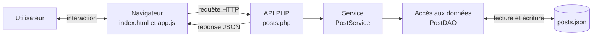

# RAPPORT DE PROJET

## Réseau Pro
### Application web de gestion de publications — CRUD

<br>

**Réalisé par :** Badreddine Hammam  
**Encadré par :** Mr.ESSARRAJ fouad

<br>

**Projet de développement web**  
**Année de formation :** 2027_2026

---

## Résumé

Ce rapport présente **Réseau Pro**, une application web de démonstration qui permet de gérer des publications dans un fil professionnel. Le projet met en pratique les quatre opérations CRUD : créer une publication, la lire, la modifier et la supprimer.

L’interface est réalisée en HTML et JavaScript. Elle communique avec une API PHP, qui vérifie les demandes et s’appuie sur un fichier JSON pour conserver les données. Le projet est conçu comme un support d’apprentissage : il montre le trajet d’une donnée entre le navigateur et le serveur sans nécessiter de framework ni de base de données.

**Mots-clés :** application web, CRUD, PHP, JavaScript, API, JSON, architecture en couches.

---

## Sommaire

- [RAPPORT DE PROJET](#rapport-de-projet)
  - [Réseau Pro](#réseau-pro)
    - [Application web de gestion de publications — CRUD](#application-web-de-gestion-de-publications--crud)
  - [Résumé](#résumé)
  - [Sommaire](#sommaire)
  - [1. Introduction générale](#1-introduction-générale)
  - [2. Présentation du projet](#2-présentation-du-projet)
    - [2.1 Contexte](#21-contexte)
    - [2.2 Objectifs](#22-objectifs)
    - [2.3 Périmètre](#23-périmètre)
  - [3. Besoins et fonctionnalités](#3-besoins-et-fonctionnalités)
    - [3.1 Besoin principal](#31-besoin-principal)
    - [3.2 Fonctionnalités](#32-fonctionnalités)
    - [3.3 Contraintes fonctionnelles constatées](#33-contraintes-fonctionnelles-constatées)
  - [4. Méthodologie de conception](#4-méthodologie-de-conception)
    - [4.1 Repère 2TUP](#41-repère-2tup)
    - [4.2 Repère Design Thinking](#42-repère-design-thinking)
  - [5. Choix technologiques](#5-choix-technologiques)
  - [6. Architecture du système](#6-architecture-du-système)
    - [6.1 Organisation en couches](#61-organisation-en-couches)
    - [6.2 Schéma des échanges](#62-schéma-des-échanges)
    - [6.3 Rôle des fichiers principaux](#63-rôle-des-fichiers-principaux)
  - [7. Modèle de données](#7-modèle-de-données)
  - [8. Fonctionnement des opérations CRUD](#8-fonctionnement-des-opérations-crud)
    - [8.1 Exemple du parcours d’une création](#81-exemple-du-parcours-dune-création)
  - [9. Interface et expérience utilisateur](#9-interface-et-expérience-utilisateur)
  - [10. Vérification et tests](#10-vérification-et-tests)
  - [11. Installation et utilisation](#11-installation-et-utilisation)
    - [11.1 Prérequis](#111-prérequis)
    - [11.2 Démarrage local](#112-démarrage-local)
    - [11.3 Utilisation](#113-utilisation)
  - [12. Limites et améliorations possibles](#12-limites-et-améliorations-possibles)
    - [12.1 Limites actuelles](#121-limites-actuelles)
    - [12.2 Évolutions envisageables](#122-évolutions-envisageables)
  - [13. Conclusion générale](#13-conclusion-générale)
  - [Glossaire](#glossaire)
  - [Références](#références)

---

<a id="introduction-generale"></a>
## 1. Introduction générale

Les applications web manipulent souvent des données que l’utilisateur doit pouvoir ajouter, consulter, mettre à jour et supprimer. Ces actions forment le CRUD, une base essentielle du développement logiciel.

Le projet **Réseau Pro** applique ce principe à un fil de publications professionnelles. Il a pour objectif de proposer un exemple réduit et compréhensible du fonctionnement d’une application web complète : une interface dans le navigateur, un traitement côté serveur et un support de stockage.

Ce rapport décrit les besoins couverts, les technologies réellement utilisées, l’organisation du code, le fonctionnement des opérations et les vérifications disponibles.

---

<a id="presentation-du-projet"></a>
## 2. Présentation du projet

### 2.1 Contexte

Réseau Pro est une petite application d’apprentissage inspirée d’un fil professionnel. Une publication comprend le nom de son auteur, son métier, un texte et une date. L’utilisateur peut gérer ces publications à partir d’une page web.

Les profils et les messages présents dans le projet sont des **données de démonstration**. L’application ne propose ni inscription ni connexion et ne distingue pas les droits de plusieurs utilisateurs.

### 2.2 Objectifs

Les objectifs principaux sont les suivants :

- comprendre les quatre opérations CRUD ;
- apprendre comment JavaScript envoie une requête à une API PHP ;
- séparer l’interface, le traitement et l’accès aux données ;
- vérifier les données avant de les enregistrer ;
- conserver les publications dans un fichier JSON facile à examiner.

### 2.3 Périmètre

Le projet couvre la gestion de publications dans un fil partagé. Les commentaires, les réactions, les messages privés, les comptes utilisateurs et les outils d’administration ne font pas partie de cette version.

---

<a id="besoins-et-fonctionnalites"></a>
## 3. Besoins et fonctionnalités

### 3.1 Besoin principal

L’utilisateur doit pouvoir gérer facilement une publication depuis une même interface, sans manipuler directement le fichier de données.

### 3.2 Fonctionnalités

| Fonctionnalité | Description |
|---|---|
| Créer une publication | Saisir un nom, un métier et un texte, puis publier le message. |
| Lire les publications | Afficher les messages enregistrés dans le fil, du plus récent au plus ancien. |
| Modifier une publication | Charger les champs d’un message existant, les corriger et enregistrer les changements. |
| Supprimer une publication | Demander confirmation, puis retirer le message du fil. |
| Valider les champs | Refuser les champs vides et les textes qui dépassent les longueurs autorisées. |

### 3.3 Contraintes fonctionnelles constatées

- Le nom est limité à 80 caractères.
- Le métier est limité à 100 caractères.
- Le contenu est limité à 1 000 caractères.
- Le nom, le métier et le contenu sont obligatoires.
- Une modification ou une suppression nécessite un identifiant valide correspondant à une publication existante.

---

<a id="methodologie-de-conception"></a>
## 4. Méthodologie de conception

### 4.1 Repère 2TUP

Les documents de référence présentent la méthode **2TUP** (*Two Tracks Unified Process*). Elle sépare l’analyse en deux branches complémentaires avant leur réunion dans la réalisation :

- **Branche fonctionnelle :** définir les besoins, ici la gestion des publications par les opérations CRUD.
- **Branche technique :** choisir une solution adaptée au besoin, ici HTML, JavaScript, PHP et un fichier JSON.
- **Réalisation :** réunir ces deux branches pour concevoir, développer et vérifier l’application.

Le schéma ci-dessous illustre le cycle en Y fourni dans les ressources du rapport.


*Figure 1 — Schéma général du cycle en Y (document de référence).*

Cette méthode est présentée comme un **cadre de compréhension** du projet. Le code disponible ne permet pas d’affirmer que toutes les phases formelles de 2TUP ont été suivies.

### 4.2 Repère Design Thinking

Le Design Thinking est une démarche centrée sur la compréhension des utilisateurs. Ses étapes classiques sont :

1. **Empathie :** comprendre les besoins et les difficultés des utilisateurs.
2. **Définition :** formuler clairement le problème.
3. **Idéation :** imaginer différentes solutions.
4. **Prototype :** créer une première version simple.
5. **Test :** essayer cette version et l’améliorer grâce aux retours.

Dans le cadre de ce projet, l’application constitue un prototype simple pour expérimenter la publication et la gestion de messages. Aucune enquête ou séance de test utilisateur n’est documentée dans le code fourni.


*Figure 2 — Les cinq étapes du Design Thinking (document de référence).*

---

<a id="choix-technologiques"></a>
## 5. Choix technologiques

Les choix ci-dessous correspondent aux fichiers présents dans le projet.

| Technologie ou outil | Utilisation dans le projet |
|---|---|
| **HTML** | Structure de la page et du formulaire (`index.html`). |
| **Tailwind CSS** | Mise en forme de l’interface, chargé depuis un CDN. |
| **JavaScript** | Gestion du formulaire, des actions et des appels réseau (`fetch`). |
| **PHP** | Traitement des demandes de l’API et validation côté serveur. |
| **JSON** | Stockage des publications dans `backend/data/posts.json`. |
| **PHP CLI** | Démarrage du serveur local et exécution des tests. |

Le projet n’utilise pas Laravel, Composer ou MySQL. Une connexion Internet est nécessaire pour charger Tailwind CSS depuis son CDN ; le fonctionnement du serveur PHP et des données ne dépend pas d’une base de données externe.

---

<a id="architecture-du-systeme"></a>
## 6. Architecture du système

### 6.1 Organisation en couches

Le projet est organisé en trois parties simples :

1. **Présentation :** `index.html` et `assets/js/app.js` affichent les publications et recueillent les actions de l’utilisateur.
2. **Traitement :** `backend/api/posts.php` reçoit les requêtes HTTP et `PostService.php` applique les règles de validation.
3. **Accès aux données :** `PostDAO.php` lit et écrit les publications dans `backend/data/posts.json`.

Cette organisation rappelle une architecture en trois tiers. Elle offre aussi un repère proche du modèle MVC, mais le projet **n’applique pas MVC strictement** : il n’utilise pas un framework MVC ni un système séparé de vues côté serveur.

### 6.2 Schéma des échanges



*Figure 3 — Les couches de l’application et leurs échanges.*

### 6.3 Rôle des fichiers principaux

| Fichier | Responsabilité |
|---|---|
| `index.html` | Présenter le fil et le formulaire de publication. |
| `assets/js/app.js` | Envoyer les requêtes, afficher les messages et construire les cartes de publication. |
| `backend/api/posts.php` | Interpréter la méthode HTTP et retourner une réponse JSON. |
| `backend/classes/Post.php` | Représenter les données d’une publication. |
| `backend/services/PostService.php` | Valider les champs et coordonner les opérations. |
| `backend/dao/PostDAO.php` | Lire, créer, modifier et supprimer les données dans le fichier JSON. |
| `backend/data/posts.json` | Conserver les publications. |
| `tests/test_post.php` | Vérifier les opérations et quelques erreurs attendues. |

---

<a id="modele-de-donnees"></a>
## 7. Modèle de données

Le modèle métier principal est **Post**. Chaque publication contient :

| Champ | Type | Rôle |
|---|---|---|
| `id` | Entier | Identifiant unique utilisé pour retrouver la publication. |
| `author` | Texte | Nom de l’auteur. |
| `role` | Texte | Métier ou fonction de l’auteur. |
| `content` | Texte | Contenu de la publication. |
| `createdAt` | Texte (date ISO) | Date et heure de création. |

Les objets sont conservés dans un tableau JSON. Exemple simplifié :

```json
{
  "id": 1,
  "author": "Amine Benali",
  "role": "Développeur web junior",
  "content": "Je découvre les API PHP.",
  "createdAt": "2026-11-12T09:30:00+00:00"
}
```

Le JSON est adapté à ce prototype et facile à lire. Pour une application multi-utilisateur ou utilisée par plusieurs personnes en même temps, une base de données serait plus appropriée.

---

<a id="fonctionnement-des-operations-crud"></a>
## 8. Fonctionnement des opérations CRUD

L’API utilise une seule adresse, `backend/api/posts.php`. La méthode HTTP indique l’action demandée.

| Action CRUD | Méthode HTTP | Fonctionnement |
|---|---|---|
| **Read — lire** | `GET` | Le serveur lit les données et retourne la liste en JSON. |
| **Create — créer** | `POST` | Le serveur vérifie les champs, crée un identifiant et enregistre la publication. |
| **Update — modifier** | `PUT` | Le serveur vérifie l’identifiant et les champs, puis met à jour la publication. |
| **Delete — supprimer** | `DELETE` | Le serveur vérifie l’identifiant puis retire la publication du fichier. |

### 8.1 Exemple du parcours d’une création

1. L’utilisateur complète le formulaire dans le navigateur.
2. `app.js` envoie les valeurs à l’API.
3. `posts.php` transmet les valeurs à `PostService`.
4. Le service retire les espaces inutiles et vérifie que les champs sont valides.
5. `PostDAO` ajoute la nouvelle publication au fichier JSON.
6. L’API renvoie un résultat JSON et l’interface recharge le fil.

Les opérations de modification et de suppression suivent le même principe, avec l’identifiant de la publication.

---

<a id="interface-et-experience-utilisateur"></a>
## 9. Interface et expérience utilisateur

La page présente un fil professionnel avec un formulaire de création. Chaque carte de publication affiche les informations de l’auteur, la date et le texte du message.

L’interface propose également :

- un bouton **Modifier**, qui remplit le formulaire avec les informations existantes ;
- un bouton **Annuler**, disponible pendant une modification ;
- un bouton **Supprimer**, accompagné d’une confirmation ;
- des messages de succès ou d’erreur ;
- un compteur de publications ;
- une présentation adaptée aux différentes largeurs d’écran.

Les textes reçus sont insérés dans la page comme du texte, et non interprétés comme du code HTML. Cela permet d’afficher le contenu saisi sans le traiter comme un élément de page.

---

<a id="verification-et-tests"></a>
## 10. Vérification et tests

Le fichier `tests/test_post.php` vérifie les principaux comportements du service :

- création d’une publication et attribution de son identifiant ;
- lecture de la liste ;
- modification du métier et du contenu ;
- suppression et vérification de la liste vide ;
- refus d’un nom vide ;
- signalement d’une publication inexistante.

Le test utilise un fichier temporaire, ce qui évite de modifier les données de démonstration.

Pour exécuter le test, se placer dans le dossier `file_rouge` puis lancer :

```powershell
php .\tests\test_post.php
```

Le résultat attendu est un message indiquant que le test CRUD a réussi. Le code contient également des réponses HTTP d’erreur pour les données invalides, les publications introuvables et les méthodes non prises en charge.

---

<a id="installation-et-utilisation"></a>
## 11. Installation et utilisation

### 11.1 Prérequis

- PHP CLI **8.1 ou supérieur** ;
- un navigateur web ;
- une connexion Internet pour charger Tailwind CSS depuis son CDN ;
- des droits d’écriture PHP sur `backend/data/posts.json`.

Aucun serveur de base de données ni paquet Composer n’est requis.

### 11.2 Démarrage local

Depuis un terminal, ouvrir le dossier `file_rouge`, puis démarrer le serveur PHP :

```powershell
php -S localhost:8000
```

Ouvrir ensuite l’adresse <http://localhost:8000> dans le navigateur. Il faut utiliser le serveur PHP plutôt que d’ouvrir directement `index.html`, car l’application communique avec l’API à l’aide de requêtes `fetch`.

### 11.3 Utilisation

1. Pour **créer**, remplir le nom, le métier et la publication, puis choisir **Publier**.
2. Pour **lire**, consulter les publications chargées dans le fil.
3. Pour **modifier**, choisir **Modifier**, changer les champs puis enregistrer.
4. Pour **supprimer**, choisir **Supprimer** et confirmer l’action.

---

<a id="limites-et-ameliorations-possibles"></a>
## 12. Limites et améliorations possibles

### 12.1 Limites actuelles

- Aucun compte ni mécanisme de connexion n’est disponible.
- Tous les visiteurs utilisent le même fil ; les auteurs sont des champs de formulaire.
- Le stockage repose sur un fichier JSON, sans gestion avancée des accès concurrents.
- Le projet ne contient ni commentaires, ni réactions, ni messages privés.
- Tailwind CSS dépend de son CDN pour afficher la mise en forme.

### 12.2 Évolutions envisageables

Pour faire évoluer le projet, il serait possible de :

- ajouter une authentification et associer chaque publication à son auteur ;
- remplacer le fichier JSON par une base de données relationnelle ;
- ajouter des commentaires, des réactions et une recherche ;
- améliorer les validations et la documentation de l’API ;
- compléter les tests par des vérifications des réponses HTTP et de l’interface ;
- installer et compiler localement les ressources CSS pour limiter la dépendance au CDN.

Ces évolutions devraient être introduites progressivement, en conservant une séparation claire entre l’interface, les règles métier et le stockage.

---

<a id="conclusion-generale"></a>
## 13. Conclusion générale

Réseau Pro est un prototype pédagogique qui illustre le cycle CRUD à travers un cas concret : la gestion de publications dans un fil professionnel. Le navigateur envoie des requêtes à une API PHP, le service valide les données, puis le DAO les enregistre dans un fichier JSON.

La séparation des responsabilités rend le projet plus facile à comprendre et à faire évoluer. Même si cette version ne dispose pas de comptes ni d’une base de données, elle fournit une base claire pour apprendre les échanges entre JavaScript et PHP, l’utilisation d’une API et l’organisation d’un projet web.

---

## Glossaire

| Terme | Définition |
|---|---|
| **API** | Interface qui permet à des logiciels d’échanger des demandes et des réponses. |
| **CRUD** | Quatre opérations de gestion de données : Create, Read, Update, Delete. |
| **DAO** | Composant chargé de l’accès aux données et de leur stockage. |
| **JSON** | Format texte utilisé pour représenter et échanger des données structurées. |
| **PHP CLI** | Version de PHP utilisée depuis une ligne de commande ou un terminal. |
| **Requête HTTP** | Message envoyé par le navigateur au serveur, par exemple avec la méthode `GET` ou `POST`. |
| **Service** | Partie du programme qui applique des règles métier et coordonne une opération. |

---

## Références

- Code source du projet : dossier [`file_rouge`](../file_rouge/README.md).
- Architecture du système : [`architecture_du_system.md`](../rapport/architecture_du_system/architecture_du_system.md).
- Branche technique : [`branch_tecnique.md`](../rapport/Branch_Technique/branch_tecnique.md).
- Projet technique — prototype CRUD : [`projet-technique.md`](../rapport/PROJET-TECHNIQUE/projet-technique.md).
- Méthode 2TUP et schéma du cycle en Y : [`rapport-methode-agile-template.md`](../rapport/2TUP/rapport-methode-agile-template.md).
- Design Thinking : [`design_thinking.md`](../rapport/design_thinking/design_thinking.md).
