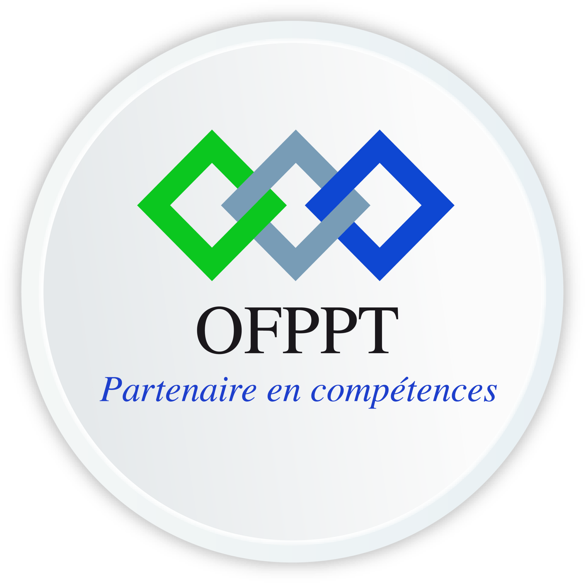
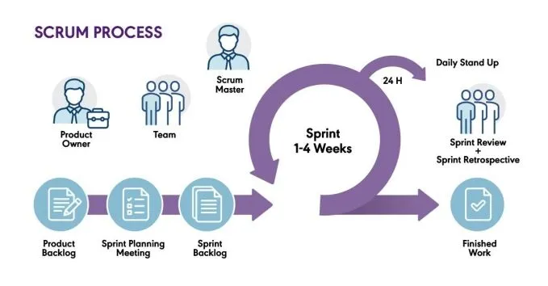
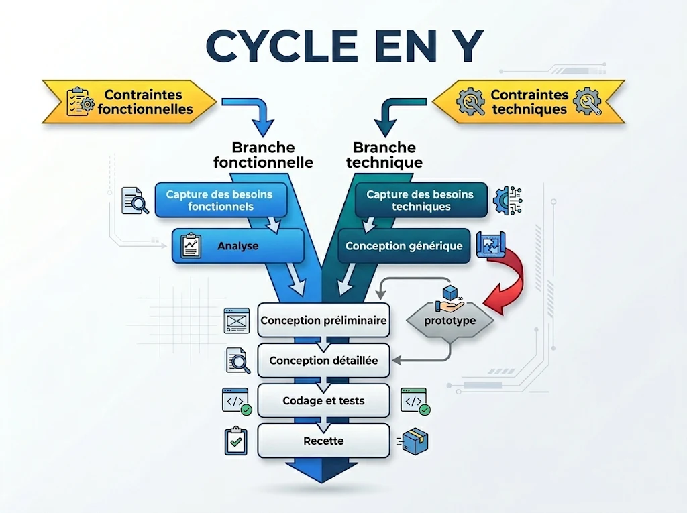
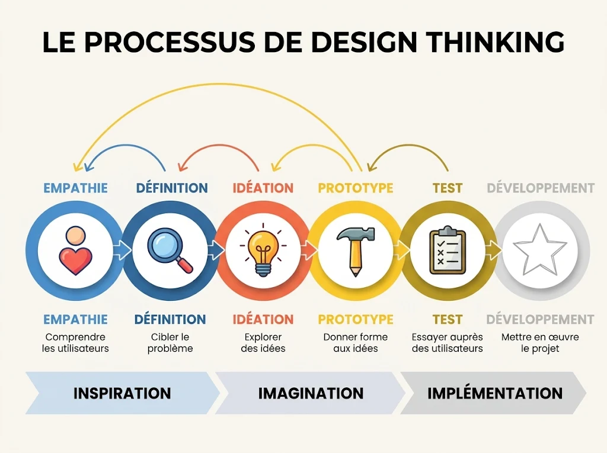
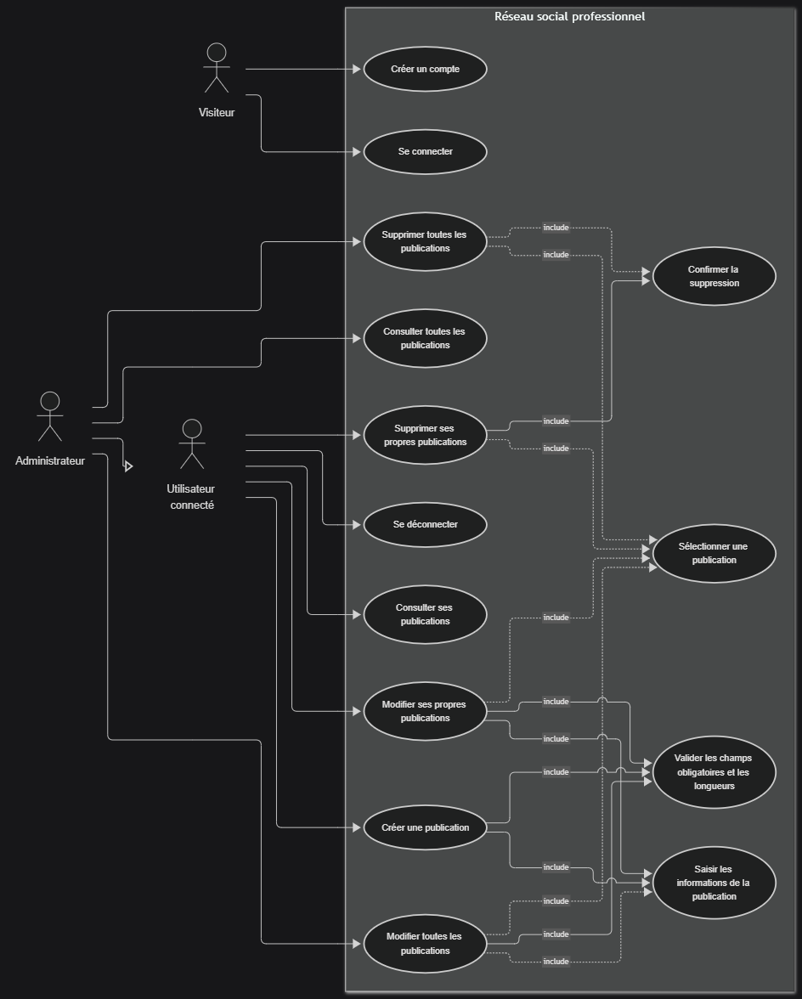
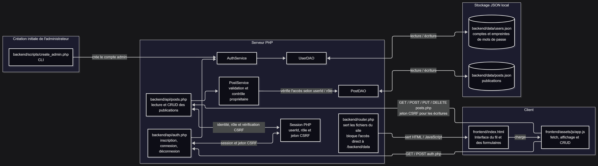
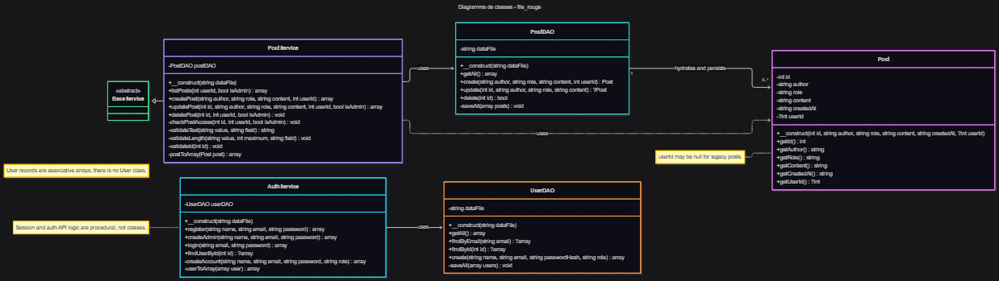

<!-- _class: title-slide -->

  
  

# Rapport de projet Réseau Pro

Realise par : Badreddine Hammam  
Encadrant : ES-Sarraj Fouad

---

## Remerciements

---

## Introduction

---

## Contexte du projet

---

## Méthode de travail

---

## Scrum

---

<!-- _class: image-slide -->

## Processus 2TUP

---

## Design Thinking

---

## Planification

---

## Branche fonctionnelle

<!-- _class: diagram-slide -->
---

## Carte d empathie

---

## definition du probleme

---
## ideation

---
## Diagrame de cas d'utilisation

---

## Stack technologique

- **Backend** · PHP 8.2 · Laravel 12
- **Autorisations** · Spatie Laravel Permission
- **Mobile** · NativePHP
- **Frontend** · Blade · Tailwind CSS · Alpine · Preline · Vite
- **Base de données** · MySQL
- **Diagrammes** · Mermaid · PlantUML

---

## Architecture

---
## Maquettes

---
## Diagramme de classes

---
## Realisation

---
## Conclusion