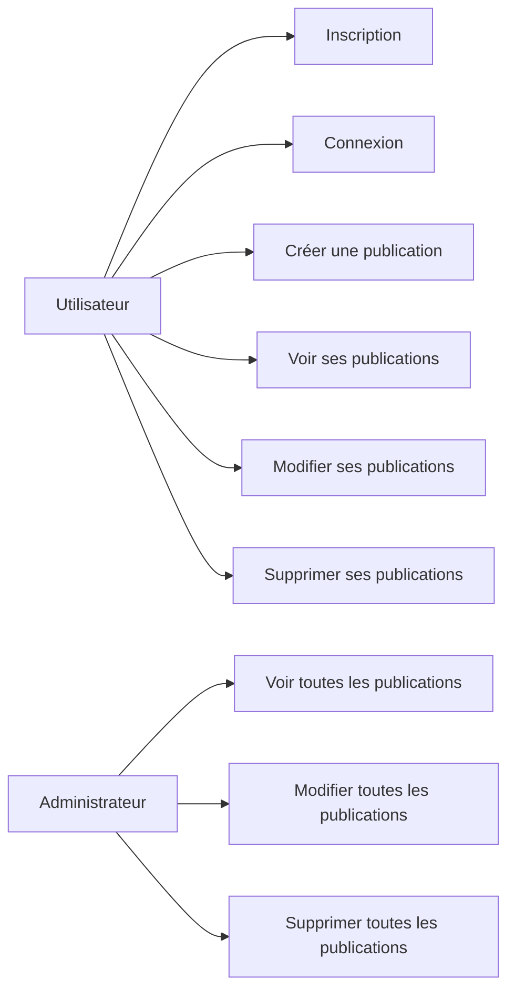

# Diagramme de cas d'utilisation

Les acteurs principaux sont l'utilisateur connecté et l'administrateur.

- **Utilisateur** : s'inscrire, se connecter, se déconnecter, créer une
  publication, consulter ses publications, modifier ses publications et
  supprimer ses publications ;
- **Administrateur** : effectuer les mêmes opérations sur toutes les
  publications du système ;
- **Système PHP** : maintenir la session, vérifier le jeton CSRF, appliquer les
  règles d'autorisation et enregistrer les données JSON.

