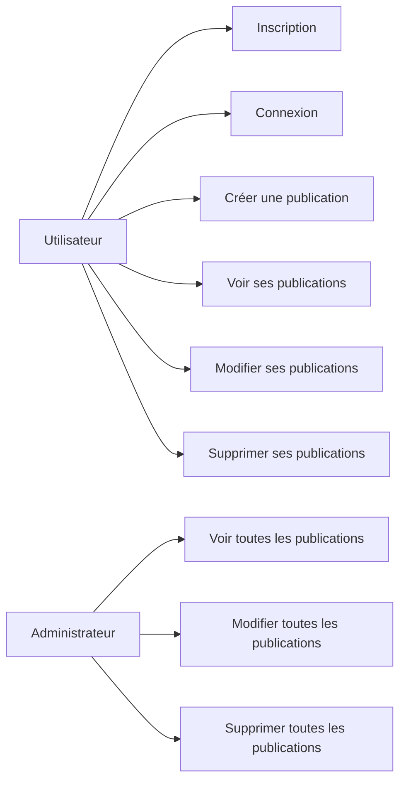
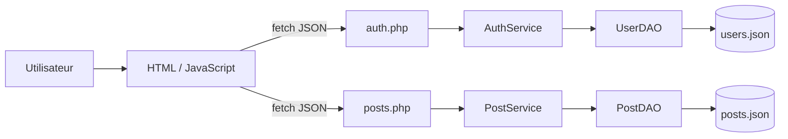

# Rapport

#### Table des matières

- [Remerciements](#remerciements)
- [Introduction](#introduction)
- [Contexte du projet](#contexte-du-projet)
- [Cahier des charges](#cahier-des-charges)
- [Méthodologie de travail](#méthodologie-de-travail)
  - [Méthodologie Scrum](#méthodologie-scrum)
  - [Processus 2TUP](#processus-2tup)
  - [Design Thinking](#design-thinking)
- [Planification](#planification)
- [Branche fonctionnelle](#branche-fonctionnelle)
  - [Carte d'empathie](#carte-dempathie)
  - [Définition du problème](#définition-du-problème)
  - [Idéation](#idéation)
  - [Diagramme de cas d'utilisation](#diagramme-de-cas-dutilisation)
- [Branche technique](#branche-technique)
  - [Stack technologique](#stack-technologique)
  - [Architecture logicielle](#architecture-logicielle)
  - [Prototype (fonctionnalités, classes)](#prototype-fonctionnalités-classes)
- [Conception](#conception)
  - [Diagramme de classes](#diagramme-de-classes)
  - [Maquettes](#maquettes)
- [Réalisation](#réalisation)
  - [Interfaces](#interfaces)
- [Conclusion](#conclusion)

## Remerciements

Nous remercions les encadrants, les formateurs et les collaborateurs ayant
contribué à l'apprentissage des concepts de développement web, d'architecture
logicielle et de gestion de projet.

## Introduction

Ce projet consiste à développer **Réseau Pro**, une application web pédagogique
de fil professionnel. Elle permet aux utilisateurs de créer un compte,
de publier des informations professionnelles et de consulter les publications
autorisées selon leur rôle.

Le prototype applique les opérations CRUD avec HTML, Tailwind CSS chargé depuis
le CDN, JavaScript et PHP. Les données sont conservées dans des fichiers JSON,
sans serveur de base de données ni framework PHP.

## Contexte du projet

Le projet est réalisé dans le cadre d'un exercice pratique d'apprentissage des
communications entre un navigateur et une API. L'application représente un
réseau professionnel simplifié dans lequel des comptes peuvent partager des
actualités professionnelles.

Le prototype distingue les utilisateurs standards et les administrateurs.
Un utilisateur standard ne consulte et ne modifie que ses propres publications,
alors qu'un administrateur peut consulter et gérer l'ensemble des publications.

## Cahier des charges

### Objectif

Mettre en place une application de fil professionnel permettant à chaque
utilisateur connecté de publier, consulter, modifier et supprimer des
publications.

### Fonctionnalités attendues

- inscription d'un compte utilisateur ;
- connexion, consultation de session et déconnexion ;
- création d'une publication contenant le nom, le métier et le contenu ;
- affichage du fil selon les droits du compte connecté ;
- modification et suppression des publications autorisées ;
- gestion administrative de toutes les publications ;
- protection des opérations d'écriture par un jeton CSRF ;
- stockage persistant des comptes et des publications dans des fichiers JSON.

### Contraintes

- utilisation de PHP, HTML, JavaScript et Tailwind CSS ;
- aucun framework PHP ni paquet Composer obligatoire ;
- aucun serveur SQL utilisé par la version actuelle ;
- lancement avec le serveur PHP intégré ;
- prévention de l'accès HTTP direct aux données JSON.

## Méthodologie de travail

Le travail est organisé autour de cycles fonctionnels courts : définition du
périmètre, réalisation d'une fonctionnalité, vérification puis correction.
Cette approche reprend les principes de Scrum, tout en utilisant le modèle
2TUP pour séparer l'analyse fonctionnelle de l'analyse technique.

Le Design Thinking apporte une grille centrée sur les besoins des utilisateurs
pour formuler le problème et orienter les solutions retenues dans le prototype.

### Méthodologie Scrum

Scrum organise le travail en cycles courts avec un objectif partagé, un suivi
régulier et une revue des résultats. Le schéma suivant illustre le cycle Scrum
général ; il ne constitue pas un calendrier de sprints spécifique au projet.

*Cycle Scrum : planification, travail de sprint, revue et rétrospective.*

Les lots fonctionnels du prototype peuvent être organisés comme suit :

1. construire l'interface et afficher le fil ;
2. ajouter l'inscription, la connexion et les sessions ;
3. ajouter les opérations CRUD sur les publications et les contrôles d'accès ;
4. vérifier les traitements avec les tests PHP dédiés.

Le dépôt ne fournit pas de dates, de durée ni de comptes rendus de sprint.
Cette liste décrit donc des lots fonctionnels, et non des sprints historiques
attribués à une équipe.

### Processus 2TUP

La méthode 2TUP sépare l'analyse fonctionnelle de l'étude technique, puis
converge vers la conception et la réalisation.

#### Branche fonctionnelle

Le produit répond au besoin d'un fil professionnel où les utilisateurs peuvent
créer un compte, se connecter, publier et gérer leurs publications. Un compte
standard ne voit et ne gère que ses propres publications ; l'administrateur
peut consulter et gérer l'ensemble du fil.

#### Branche technique

Le frontend est une page HTML avec JavaScript et Tailwind CSS chargé depuis un
CDN. Il communique avec deux API PHP. Les services appliquent les règles
métier, les DAO accèdent aux fichiers JSON et les sessions portent
l'identification, le rôle et la protection CSRF.

#### Convergence et réalisation

Les besoins fonctionnels sont pris en charge par une interface de fil et des
API d'authentification et de publications. La réalisation inclut les
opérations CRUD, les contrôles d'accès par propriétaire ou rôle administrateur
et des tests PHP.

*Schéma générique du processus 2TUP : les branches fonctionnelle et technique
convergent vers la réalisation.*

### Design Thinking

Le Design Thinking propose de partir des besoins des utilisateurs, de formuler
un problème, d'explorer des solutions, puis de les prototyper et de les tester.

  

*Étapes du Design Thinking : empathie, définition, idéation, prototype et test.*

Pour Réseau Pro, le besoin documenté est de créer et consulter des
publications professionnelles avec des comptes et des droits adaptés.

## Planification

La réalisation du prototype peut être découpée en quatre lots :

1. réalisation de l'interface HTML/Tailwind et du profil utilisateur ;
2. ajout de l'inscription, de la connexion, de la déconnexion et des sessions ;
3. ajout des API PHP pour les publications et la séparation des droits ;
4. tests des comptes et des opérations CRUD, puis validation du fonctionnement
   complet.

## Branche fonctionnelle

### Carte d'empathie

- **Ils veulent** partager une actualité professionnelle et gérer leurs
  publications ;
- **Ils voient** un fil professionnel, leur profil et les commandes disponibles
  selon leurs droits ;
- **Leurs difficultés** : utiliser une interface complexe ou modifier une
  publication appartenant à une autre personne ;
- **La solution** : des formulaires courts, des sessions PHP, des contrôles
  d'accès et des opérations CRUD simples.

### Définition du problème

La difficulté est de fournir un espace professionnel simple tout en garantissant
que les utilisateurs ne peuvent agir que conformément à leurs droits. Chaque
publication doit être associée à son auteur.

**Question centrale** : comment permettre la publication professionnelle avec
une interface simple tout en contrôlant les droits des utilisateurs et des
administrateurs ?

### Idéation

Les solutions retenues sont des formulaires HTML courts, des fichiers JSON,
JavaScript avec `fetch`, les sessions PHP, la protection CSRF et une
organisation en API, services et DAO.

### Diagramme de cas d'utilisation

- **Utilisateur** : s'inscrire, se connecter, se déconnecter, créer une
  publication, consulter ses publications, modifier ses publications et
  supprimer ses publications ;
- **Administrateur** : consulter, modifier et supprimer toutes les publications ;
- **Système PHP** : maintenir la session, vérifier le jeton CSRF, appliquer les
  droits et enregistrer les données JSON.

## Branche technique

### Stack technologique

- **PHP** : API, sessions et tests ;
- **HTML/CSS** : structure et mise en page ;
- **JavaScript** : formulaires et appels `fetch` ;
- **Tailwind CSS** : style, chargé depuis le CDN ;
- **JSON** : stockage des comptes et des publications ;
- **Serveur PHP intégré** : exécution locale ;
- **Mermaid** : diagrammes de documentation.

Le projet n'utilise pas Laravel, MySQL, Blade, Vite ou Composer.

### Architecture logicielle

L'application est organisée en couches de présentation, API, logique métier,
services et accès aux données.

Les API renvoient des réponses JSON. `PostService` valide les champs et vérifie
la propriété des publications. `AuthService` gère les comptes et les mots de
passe avec des empreintes sécurisées.

### Prototype (fonctionnalités, classes)

- `Post` : contient l'identifiant, l'auteur, le métier, le contenu, la date et
  l'utilisateur ;
- `PostService` : valide les publications et vérifie les droits ;
- `PostDAO` : lit et écrit `posts.json` ;
- `AuthService` : inscrit et authentifie les utilisateurs ;
- `UserDAO` : lit et écrit `users.json` ;
- `BaseService` : fournit les validations communes.

Les opérations CRUD utilisent `POST`, `GET`, `PUT` et `DELETE`. Les opérations
d'écriture exigent une session valide et un jeton CSRF.

## Conception

La conception sépare la présentation, les API, les services métier et les DAO.
Les sessions PHP portent l'identifiant, le rôle et le jeton CSRF nécessaires
aux contrôles d'accès.

### Diagramme de classes

| Élément | Rôle |
|---|---|
| `Post` | Représente une publication. |
| `PostService` | Valide les données et vérifie les droits. |
| `PostDAO` | Persiste les publications dans `posts.json`. |
| `AuthService` | Inscrit et authentifie les comptes. |
| `UserDAO` | Persiste les comptes dans `users.json`. |

### Maquettes

L'interface contient un panneau d'authentification, le formulaire de
publication, le fil professionnel, le profil utilisateur et une zone
d'informations complémentaires.

## Réalisation

La réalisation comprend une interface HTML/JavaScript, deux API PHP, des
services, des DAO et deux fichiers JSON.

Le serveur PHP intégré sert l'application depuis le dossier `file_rouge`.
`frontend/index.html` affiche les formulaires et le fil, tandis que
`frontend/assets/js/app.js` effectue les appels `fetch`, traite les réponses
JSON et affiche les messages.

Les comptes sont dans `backend/data/users.json` et les publications dans
`backend/data/posts.json`. Les tests PHP se trouvent dans
`backend/tests/test_auth.php` et `backend/tests/test_post.php`.

### Interfaces

L'interface permet de créer un compte, se connecter et publier une actualité
professionnelle. Chaque carte affiche l'auteur, son métier, sa date de création
et son contenu.

Les boutons Modifier et Supprimer sont visibles uniquement pour le propriétaire
ou pour un administrateur. Les opérations d'écriture sont protégées par une
session et un jeton CSRF.

## Conclusion

Le prototype Réseau Pro atteint les objectifs pédagogiques du projet : une
interface communique avec des API PHP et les données sont conservées dans des
fichiers JSON. L'application prend en charge l'inscription, la connexion, la
déconnexion, le CRUD des publications et les droits utilisateur ou
administrateur.

Pour une évolution vers une utilisation réelle, il serait possible d'utiliser
une base relationnelle, d'ajouter davantage de tests et de renforcer encore
les mécanismes de sécurité et de déploiement.
